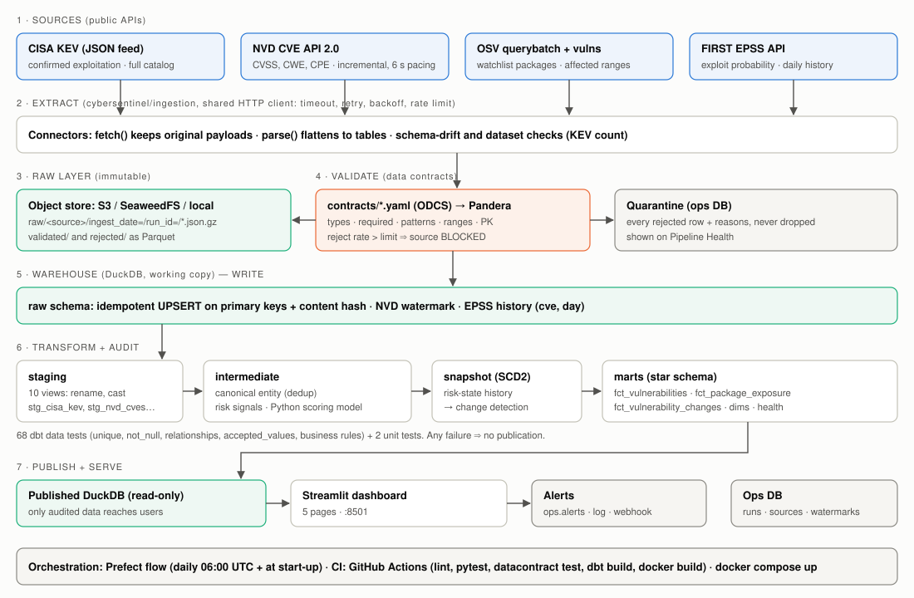

# CyberSentinel

**Cyber threat intelligence and vulnerability prioritisation — a DataOps platform.**

CyberSentinel collects vulnerability information every day from four official public sources,
validates it against data contracts, merges it into one deduplicated DuckDB warehouse with dbt,
ranks every vulnerability with an explainable scoring engine, detects what changed since the
previous run, raises alerts, and serves the result in a Streamlit dashboard. Only data that has
passed every check is published.

It is a defensive analytics project. It does not scan systems, exploit anything or automate attacks.



| | |
|---|---|
| Sources | CISA KEV · NIST NVD (CVE API 2.0) · OSV · FIRST EPSS — all real, all public |
| Stack | Python 3.12 · requests · Pandera · ODCS data contracts · DuckDB · dbt-duckdb · Prefect 3 · Streamlit · Docker Compose · GitHub Actions |
| Layers | raw (object store) → validated → DuckDB `raw` → dbt `staging` → `intermediate` → `snapshots` → `marts` → published copy |
| Beyond the course | explainable prioritisation engine, change detection (dbt snapshot), write-audit-publish, version-range re-verification, alert deduplication, offline replay mode |

Documentation: [project proposal](docs/proposal.md) · [architecture](docs/architecture.md) ·
[gap analysis vs TP1–TP4](docs/gap_analysis.md) · [data dictionary](docs/data_dictionary.md) ·
[prioritisation method](docs/prioritization.md) · [component reference](docs/components.md) ·
[AWS deployment plan](docs/deployment_aws.md) · [defence Q&A](docs/defense_qa.md)

---

## 1. Quick start with Docker (the whole platform, one command)

Requirements: Docker Desktop (or Docker Engine + Compose v2), ~2 GB free disk, internet access.

```bash
git clone <repository-url> cybersentinel && cd cybersentinel
cp .env.example .env
```

Edit `.env` and set at least `S3_SECRET_KEY` (any local secret, 8+ characters). `NVD_API_KEY`
is optional ([free key](https://nvd.nist.gov/developers/request-an-api-key)); without it NVD is
queried in reduced-rate mode (one request every 6 s).

```bash
docker compose up --build
```

| URL | What |
|---|---|
| http://localhost:8501 | Dashboard |
| http://localhost:4200 | Prefect UI: flow runs, task timings, the daily schedule |

What happens: the `pipeline` service runs the pipeline once at start-up, then every day at
06:00 UTC. The first run backfills 7 days of NVD changes plus every KEV CVE and takes about
**10 minutes without an NVD key** (most of it is the polite 6-second NVD pacing). The dashboard
shows "No published data yet" until that first run is published; Pipeline Health shows progress.

Stop: `docker compose down` (data is kept in volumes) · reset everything: `docker compose down -v`.

## 2. Local development (without Docker)

```bash
python -m venv .venv
# Windows: .venv\Scripts\activate   ·   macOS/Linux: source .venv/bin/activate
pip install -r requirements-dev.txt
pip install -e .
```

Python 3.12 is required (it is what Docker and CI use). The raw layer is written to the local
disk (`data/lake/`) unless `RAW_STORAGE=s3` is set.

| Command | What it does |
|---|---|
| `python -m cybersentinel run` | Run the whole pipeline once against the live APIs |
| `python -m cybersentinel run --sources cisa_kev osv` | Run only some sources (dbt still runs on everything) |
| `python -m cybersentinel run --replay` | Offline demo: replays recorded real API responses into `data-replay/` |
| `python -m cybersentinel status` | Latest runs and per-source results |
| `python -m orchestration.flows` | Run once as a Prefect flow (local temporary Prefect server) |
| `streamlit run dashboard/app.py` | Dashboard on http://localhost:8501 |
| `pytest` | Unit + integration tests (offline, ~3 min) |
| `pytest -m live tests/live` | One real request per API, validated against its contract |
| `ruff check . && ruff format --check .` | Lint and formatting |

To run dbt by hand: `cd warehouse && dbt build --profiles-dir .` (paths default to `../data/...`).

## 3. How it works (one paragraph per layer)

1. **Extract** — one connector per source in `cybersentinel/ingestion/`. They share an HTTP client
   with timeouts, retries with exponential backoff, `Retry-After` support and per-API pacing. NVD
   is incremental (watermark on `lastModified`, 120-day windows, 15-minute overlap); OSV only
   re-downloads advisories whose `modified` date changed; EPSS asks for 30 days of history the first
   time a CVE is seen, then only the daily score.
2. **Raw layer** — every original API response is stored unmodified, gzip-compressed, in a
   source/date/run partition (`raw/<source>/ingest_date=…/run_id=…/`), with a manifest of request
   parameters and SHA-256 hashes. Files are never overwritten. The same code writes to the local
   disk, to the S3-compatible store in Docker, or to AWS S3.
3. **Validate** — each flattened table has an ODCS data contract in `contracts/`. The validator turns
   it into a Pandera schema: types, required fields, CVE-ID pattern, value ranges (CVSS 0–10, EPSS
   0–1), allowed values and primary-key uniqueness. Bad rows are quarantined with their reasons;
   if too many are bad (contract `maxRejectRate`), or the structure changed, the whole source is
   **blocked** for this run. CI runs the same contracts through `datacontract test`.
4. **Load** — validated rows are upserted into DuckDB `raw.*` on their primary key. A content hash
   means an unchanged record is not touched: running twice changes nothing.
5. **Transform + audit** — `dbt build` builds 10 staging views, 6 intermediate models (including the
   canonical deduplicated vulnerability, and a Python model that runs the scoring engine), one
   snapshot (history of each vulnerability's risk state), and 10 marts, and runs 68 data tests and
   2 dbt unit tests.
6. **Publish** — only if every dbt test passed, the warehouse file is copied atomically to the
   published location that the dashboard reads (write-audit-publish). Otherwise the dashboard keeps
   showing the last good version and a `PIPELINE_FAILED` alert is raised.
7. **Alert** — new KEV entries, new Critical/High vulnerabilities, escalations to Critical, newly
   affected watched packages, failed or blocked sources, stale sources. Stored in `ops.alerts`,
   logged, and optionally POSTed to a webhook. Re-runs never resend an alert.

## 4. Business questions and where they are answered

| # | Question | Model | Dashboard |
|---|---|---|---|
| Q1 | Which vulnerabilities affect the packages in our watchlist? | `fct_package_exposure` | Package Exposure |
| Q2 | Which vulnerabilities have the highest remediation priority? | `fct_vulnerabilities` | Overview, Explorer |
| Q3 | What is new or changed since the previous ingestion? | `fct_vulnerability_changes` | Threat Intelligence |
| Q4 | Which vulnerabilities are confirmed as actively exploited? | `fct_vulnerabilities.is_kev` | Overview, Threat Intelligence |
| Q5 | How have EPSS scores changed over time? | `fct_epss_history` | Threat Intelligence, Explorer detail |
| Q6 | Which ecosystems and vendors have the highest exposure? | `dim_vendor`, `fct_package_exposure` | Overview |

## 5. Repository layout

```
cybersentinel/            Python package (pipeline)
  ingestion/              cisa.py nvd.py osv.py epss.py, versions.py (range checks), watchlist.py
  storage/raw_store.py    raw layer on local disk / S3-compatible storage
  validation/             contract loader + contract-driven Pandera validator
  loading/                DuckDB warehouse (idempotent upsert), ops state, publish
  prioritization/         explainable scoring engine + rule loader
  alerts/                 alert generation and delivery
  pipeline.py             step order (shared by CLI and Prefect)
  transform.py            runs dbt build
  replay.py               offline replay of recorded responses
orchestration/            Prefect flow + scheduler entry point
warehouse/                dbt project (staging, intermediate, snapshots, marts, tests)
contracts/                ODCS data contracts, one per source table
config/                   watchlist.yaml (demo inventory), scoring.yaml (prioritisation rules)
dashboard/                Streamlit app (5 pages)
tests/                    unit/, integration/ (replay), live/ (real APIs), fixtures/ (recorded responses)
docs/                     proposal, architecture, data dictionary, defence Q&A, …
.github/workflows/        ci.yml (mandatory), smoke.yml (live APIs), deploy.yml (manual, disabled)
```

## 6. Configuration

All configuration is through environment variables (see `.env.example`) and two YAML files that
can be edited without code changes:

- `config/watchlist.yaml` — the packages to monitor (name, ecosystem, exact version, owner).
  The bundled list is a **demonstration inventory**, not a real organisation's.
- `config/scoring.yaml` — the prioritisation weights, EPSS bands, tier thresholds and floors.

Secrets (`NVD_API_KEY`, `ALERT_WEBHOOK_URL`, `S3_SECRET_KEY`) are read from the environment only;
`.env` is git-ignored and the logger masks the NVD key and webhook URL.

## 7. Verified status (what was actually run)

Verified in this repository on Windows 11 with Python 3.12 and Docker 29.8:

- Live runs against all four APIs: 1,781 KEV entries (count check passed), 11,618 NVD CVEs
  (7-day backfill + KEV bootstrap, reduced-rate mode, no API key), 178 OSV advisories for the
  10 demo packages, 200,518 EPSS daily scores (11,252 CVEs, 30-day history). 11,562 canonical
  vulnerabilities after deduplication. Two real NVD CPE records with an empty product were
  quarantined by the contract.
- Re-running with no upstream change: 0 inserted / 0 updated rows for KEV, OSV and EPSS; no new
  snapshot rows; no duplicate alerts.
- Write-audit-publish: a dbt failure during development left the published warehouse untouched and
  raised `PIPELINE_FAILED`.
- `pytest`: 66 offline tests pass (60 unit, 6 end-to-end on recorded responses); 4 live tests pass.
- `datacontract test` passes on all 8 contracts and fails (exit 1) on a corrupted fixture.
- `ruff check` and `ruff format --check` pass.
- `docker compose up` from fresh volumes: all services healthy, the start-up run succeeded in ~8.5 min
  inside the container (raw layer in the S3 object store, 70 dbt tests passed, published), and the
  daily Prefect deployment was registered. Details in `docs/architecture.md` §8.

Not done yet (planned): AWS deployment (configuration and plan only — no cloud resource was
created), an NVD API key in CI secrets, retention/compaction of old raw snapshots.

## 8. Team rules

Nothing reaches `main` without a reviewed pull request; CI must be green. Do not commit `.env`,
data files or API keys. The course archive and PDF are kept locally and are not part of the repo.
