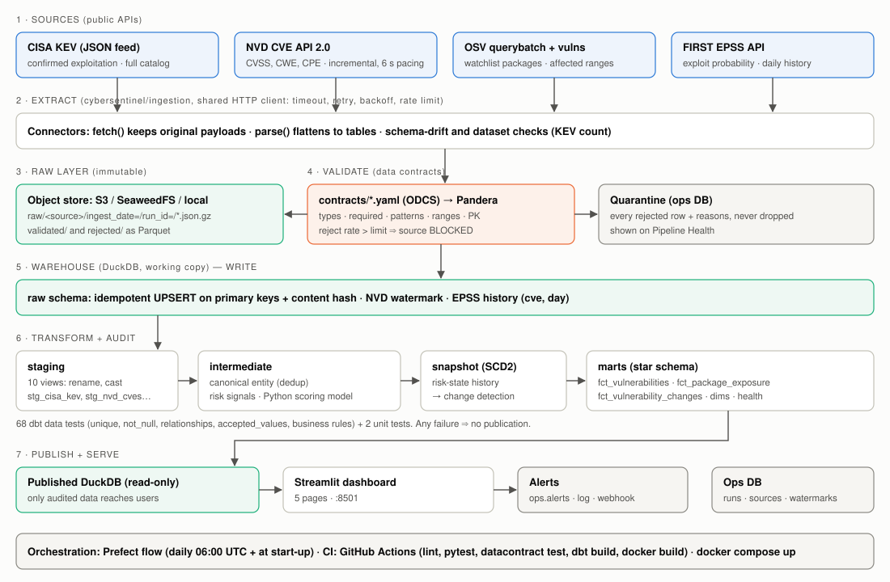

# Architecture



## 1. In one paragraph

Four connectors download the official vulnerability sources and store every original response in an
immutable raw layer (S3 API). Each response is flattened and checked against an ODCS data contract;
bad rows are quarantined, and a source whose data is broken is blocked for that run. Valid rows are
upserted into DuckDB with primary keys and content hashes, so re-running changes nothing. `dbt build`
transforms the data in layers (staging → intermediate → snapshot → marts), runs the scoring engine,
records the history of each vulnerability's risk state, and tests everything. Only when every test
passes is the warehouse file copied atomically to the published location read by the dashboard. Alerts
are generated from the published change events. Prefect runs this daily; GitHub Actions checks every
change; Docker Compose starts it all.

## 2. Data flow and dependencies

```
cisa_kev ─┐
          ├─► nvd (needs KEV/OSV CVE IDs for look-ups) ─► epss (scores every tracked CVE) ─► dbt build ─► publish ─► alerts
osv ──────┘
```

Each source goes through the same five steps: extract → save raw → validate → quarantine rejects →
load. Steps are defined once in `cybersentinel/pipeline.py::run_steps`; Prefect wraps each step as a
task.

## 3. Core entities

- **Vulnerability** (canonical) — key `vulnerability_id` = CVE ID, or the OSV ID when an advisory has
  no CVE alias. Built in `int_vulnerability_enrichment`; one row whatever the number of sources.
- **Source records** — one per source and natural key (`cve_id` for KEV/NVD, `osv_id` for OSV,
  `(cve_id, score_date)` for EPSS); kept separately for provenance.
- **Package** — a watched (name, ecosystem, version) from `config/watchlist.yaml`.
- **Exposure** — (package, vulnerability) with a verdict and a fixed version.
- **Risk state version** — snapshot row; a new one only when a tracked field changes.
- **Change event** — derived from consecutive risk-state versions and EPSS history.
- **Run / source run / alert / quarantined record** — operational entities in the ops database.

## 4. Source schemas (what we read)

| Source | Top level | Per record (fields used) |
|---|---|---|
| CISA KEV | `title, catalogVersion, dateReleased, count, vulnerabilities[]` | `cveID, vendorProject, product, vulnerabilityName, dateAdded, shortDescription, requiredAction, dueDate, knownRansomwareCampaignUse, notes, cwes` |
| NVD 2.0 | `resultsPerPage, startIndex, totalResults, timestamp, vulnerabilities[].cve` | `id, sourceIdentifier, published, lastModified, vulnStatus, descriptions[lang=en], metrics.cvssMetricV31/V30/V40/V2, weaknesses, configurations[].nodes[].cpeMatch[].criteria, references[].tags` |
| OSV | querybatch `results[].vulns[{id, modified}]`, `next_page_token`; vuln detail | `id, aliases, summary, details, published, modified, withdrawn, severity[], database_specific.severity, affected[].package/ranges/events/versions` |
| EPSS | `status, total, offset, limit, data[]` | `cve, epss, percentile, date, time-series[]` |

## 5. Storage

| Store | Technology | Content | Why |
|---|---|---|---|
| Raw layer | S3 API (SeaweedFS in Docker, local disk in dev, AWS S3 in the cloud) | original responses (gzip JSON), validated/rejected Parquet | immutable, replayable, cheap |
| Working warehouse | DuckDB file | raw, staging, intermediate, snapshots, marts | single-file OLAP, taught in TP3 |
| Published warehouse | DuckDB file (copy) | the last audited warehouse | the dashboard never sees unaudited data |
| Ops database | DuckDB file | runs, source runs, quarantine, watermarks, alerts | failed runs are recorded even when nothing is published |

## 6. Reliability properties

| Property (brief) | How |
|---|---|
| Automatic | Prefect daily cron + run at start-up |
| Reliable | contracts + quarantine + blocked sources + 68 dbt data tests + 2 unit tests + write-audit-publish |
| Reproducible | pinned requirements, one Docker image, `docker compose up`, recorded fixtures |
| Observable | ops DB, Pipeline Health page, JSON logs, Prefect UI, alerts (incl. stale sources) |
| No duplicates | primary keys, content-hash upserts, canonical entity, dbt uniqueness tests |
| No secrets | `.env` (ignored), GitHub Secrets, masked logs |

## 7. Security of the platform itself

- Read-only database connections in the dashboard; all user filters are bound parameters.
- SQL identifiers interpolated by the loader are checked against an allow-list.
- Container runs as a non-root user; ports are bound to 127.0.0.1 only.
- API responses are validated before use; JSON is never `eval`-ed; HTML in the dashboard is escaped.
- The dashboard has no authentication and must not be exposed publicly as is.

## 8. Docker Compose verification

`docker compose up` was run on Windows 11 / Docker Desktop 29.8 with a fresh set of volumes:

- `object-store` (SeaweedFS 4.54), `prefect-server` (Prefect 3.9.3) and `dashboard` reached
  **healthy**; `pipeline` started after both dependencies were healthy.
- The start-up run executed inside the container as a Prefect flow, wrote the raw layer to the S3
  bucket in the object store, and loaded KEV and OSV; results of the full run are recorded below.

Result of the start-up run inside Docker (fresh volumes, no NVD API key):

| Step | Result |
|---|---|
| CISA KEV | 1,781 records extracted, 1,781 valid, inserted |
| OSV | 10 packages queried, 178 advisories, 812 rows over 4 tables, all valid |
| NVD | 7-day backfill + KEV bootstrap + look-ups: 45,196 rows (CVEs + CPE matches), 2 rejected (empty CPE product) and quarantined; one HTTP 429 retried automatically |
| EPSS | 200,487 daily scores (30-day history) |
| dbt build | 27 nodes built, 70 tests passed (68 data + 2 unit) |
| Publication | success, published; baseline run, so no security alert |
| Total duration | ~8.5 minutes, most of it NVD pacing (6 s per request without a key) |
| Afterwards | Prefect deployment `daily` registered with cron `0 6 * * *`; next runs visible as SCHEDULED in the Prefect UI; dashboard healthy on :8501 |
| Raw layer | 376 objects in the `cybersentinel-lake` bucket (raw/, validated/, rejected/) |
